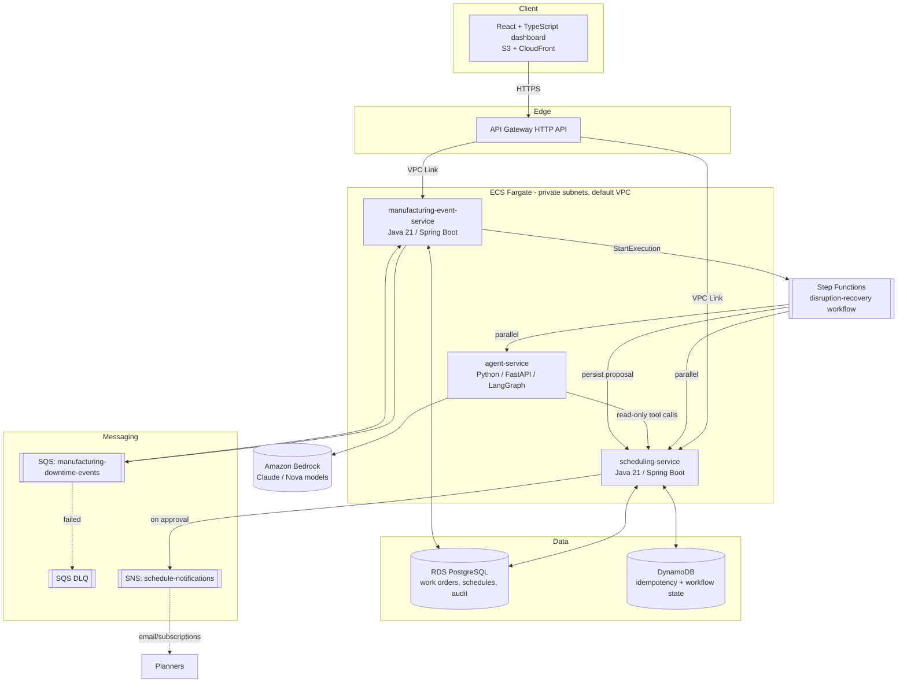

# AeroPlan AI — Architecture

Aerospace manufacturing scheduling and disruption-recovery platform. Simulated rocket-engine
factory: work orders, operation dependencies, shared resources (stations/technicians), parts,
and deadlines — with a multi-agent AI workflow that proposes recovery plans when something goes
wrong, subject to mandatory human approval.

> **Portfolio/demo project.** All manufacturing data is synthetic. This is not affiliated with
> Blue Origin; it is an independent project built to demonstrate the kind of backend engineering,
> distributed-systems design, and agentic-AI integration relevant to aerospace manufacturing
> scheduling roles.

## Priority tiers

Each workstream should build in this order. P0 must work end-to-end before polishing P1/P2.

- **P0 (core demo path):** work-order CRUD, dependency validation, deterministic scheduling
  engine, disruption ingestion, Step Functions recovery workflow (agent analysis +
  re-optimization in parallel), proposal approval with optimistic locking, React dashboard
  showing all of this live, deployed to AWS.
- **P1 (strong additions once P0 works):** GraphQL query layer, CloudWatch alarms, Terraform
  CI/CD, contract/integration test suite, DLQ redrive tooling.
- **P2 (stretch, only if time remains):** Amazon Cognito auth in front of API Gateway, OR-Tools
  based optimizer upgrade, load tests.

## Components



### Why these choices (summary — see `architecture-decisions.md` for full ADRs)

- **Java + Spring MVC + JPA** for `scheduling-service`, not WebFlux: the domain is
  transactional/relational (dependency graphs, optimistic locking, graph algorithms), not
  high-fan-out I/O. Reactive adds complexity here without a matching benefit.
- **Postgres (RDS)** owns the system of record (work orders, schedules, audit). **DynamoDB**
  owns two narrow, high-churn, key-value concerns: idempotency records and Step Functions
  workflow metadata — a deliberate polyglot-persistence choice, not "DynamoDB because AWS."
- **Step Functions (Standard)** orchestrates disruption recovery because it natively supports
  parallel branches, retries, and a `waitForTaskToken` callback for the human-approval pause —
  without resorting to polling.
- **LangGraph + Bedrock** for the agent graph. The LLM explains and compares candidate plans
  that the deterministic scheduling engine already computed; it never invents start times or
  overrides constraints. This is a hard safety rule, enforced in code (see
  `api-specification.md`).
- **No NAT Gateway, single-AZ RDS, default VPC reuse, Fargate Spot where possible** — this is a
  demo/portfolio project, not a production SLA. Cost-consciousness is itself a deliberate,
  documented engineering decision (see ADR-004), with the production upgrade path written down
  rather than silently skipped.

## Request flows

### Normal planning flow (P0)
1. Planner opens the React dashboard → calls `GET /api/schedules/current` via API Gateway.
2. Planner edits/creates work orders → `scheduling-service` validates dependencies and persists.
3. Planner requests `POST /api/schedules/optimize` → scheduling engine (topological sort +
   priority queue + resource allocation) returns a candidate `ScheduleVersion` (not yet
   published).

### Disruption recovery flow (P0 — the centerpiece)
1. A downtime simulator (or manual API call) posts `POST /api/disruptions` →
   `manufacturing-event-service`.
2. The event is also delivered via SQS (`manufacturing-downtime-events`) for the
   asynchronous/idempotent path demonstration; the event consumer validates, deduplicates
   (DynamoDB idempotency table keyed by `eventId`), and persists a `MachineDowntime` record.
3. The event consumer starts a Step Functions execution (`disruption-recovery.asl.json`) with
   the downtime event as input.
4. Step Functions runs two branches **in parallel**:
   - Call `scheduling-service` to compute 1–3 candidate re-optimized schedules.
   - Call `agent-service` (`POST /agents/analyze-disruption`) which runs the LangGraph
     supervisor + 4 specialist agents against the *same* candidate schedules, returning
     structured findings and a recommendation — not new numbers.
5. Step Functions combines both branch outputs into a `ScheduleProposal`, persists it via
   `scheduling-service`, and enters a `waitForTaskToken` state.
6. A planner opens the **AI recovery proposals** screen, reviews the comparison, and calls
   `POST /api/proposals/{id}/approve` or `/reject`. The approve endpoint sends
   `SendTaskSuccess` back to the waiting Step Functions execution.
7. On approval: `scheduling-service` commits a new immutable `ScheduleVersion`
   (optimistic-locked against the version the proposal was based on), and publishes to the
   `schedule-notifications` SNS topic.
8. Every step (1–7) writes an `AuditEvent`; the **Audit & event history** screen replays the
   whole story for any disruption.

## Local development

Each service is independently runnable (see its own `README.md`). A root `docker-compose.yml`
(owned by the integration pass, not individual workstreams) wires Postgres, DynamoDB Local,
and all three services together for local end-to-end testing before anything touches AWS.

## Repository map

```
aeroplan-ai/
├── frontend/                        React + TypeScript dashboard
├── services/
│   ├── scheduling-service/          Java 21 + Spring Boot (work orders, scheduling engine, API)
│   ├── manufacturing-event-service/ Java 21 + Spring Boot (SQS consumer, Step Functions trigger)
│   └── agent-service/               Python + FastAPI + LangGraph + Bedrock
├── algorithms/scheduling-optimizer/ Shared scheduling algorithm notes / future OR-Tools module
├── infrastructure/terraform/        All AWS infrastructure as code
├── workflows/step-functions/        Step Functions ASL definitions
├── tests/{integration,contract,load}
└── docs/                            This file + data model, API spec, ADRs, infra spec
```
