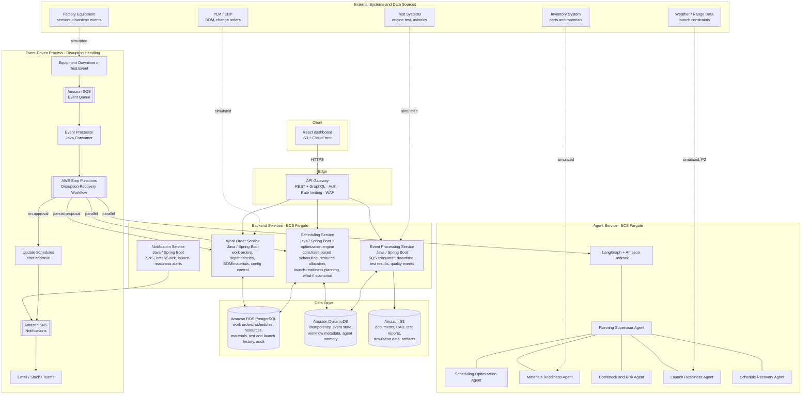

# AeroPlan AI — Architecture

Aerospace manufacturing, assembly, integration, test, and launch scheduling platform. Simulated
rocket (e.g. "New Glenn"-style) manufacturing program: work orders, operation dependencies,
shared resources (assembly stations, test stands, clean rooms, technicians), parts, test
results, and launch readiness — with a multi-agent AI workflow that proposes recovery plans when
something goes wrong, subject to mandatory human approval.

> **Portfolio/demo project.** All manufacturing, rocket, and launch data is synthetic. This is
> not affiliated with Blue Origin or any employer; it is an independent project built to
> demonstrate the kind of backend engineering, distributed-systems design, and agentic-AI
> integration relevant to aerospace manufacturing scheduling roles.

## Priority tiers

Each workstream should build in this order. P0 must work end-to-end before polishing P1/P2.

- **P0 (core demo path):** rocket/work-order CRUD, dependency validation, deterministic
  scheduling engine, disruption ingestion (equipment downtime + test-result events), Step
  Functions recovery workflow (parallel specialist-agent analysis + re-optimization), proposal
  approval with optimistic locking, React dashboard showing all of this live, deployed to AWS.
- **P1 (strong additions once P0 works):** GraphQL query layer, launch-readiness scoring,
  CloudWatch alarms, Terraform CI/CD, contract/integration test suite, DLQ redrive tooling,
  Slack/email notification delivery.
- **P2 (stretch, only if time remains):** Amazon Cognito auth in front of API Gateway, OR-Tools
  based optimizer upgrade, "what-if" scenario sandboxing, load tests, simulated external-system
  integrations (weather/range data, PLM/ERP).

## Functional requirements (source brief)

- Schedule manufacturing, assembly, integration, test, and launch operations (e.g. New Glenn).
- Manage work orders, dependencies, resources (people, stations), and materials.
- Handle equipment downtime, part delays, and launch-readiness constraints.
- Detect bottlenecks, predict delays, and recommend recovery plans using AI agents.
- Provide real-time dashboards for planners, engineers, and leadership.
- Support "what-if" scenarios for launch-schedule impact (P1/P2).
- Track configuration changes, quality checks, and audit trail.
- Require human approval before publishing new schedules.
- Send notifications to affected teams.
- Integrate with external systems (inventory, ERP, test systems, telemetry simulators) — modeled
  as simulated/stubbed data sources for this demo, not real integrations (see "External systems"
  below).

## Non-functional requirements

| Concern | Target for this project |
| --- | --- |
| Scalability | Handles thousands of work orders and events without redesign |
| Availability | Demo target: single-AZ, cost-conscious (see ADR-004); production target documented as 99.9%, multi-AZ |
| Performance | API p95 < 500ms for read endpoints |
| Reliability | Idempotent event processing, retries, DLQ |
| Security | IAM least privilege, encryption at rest/in transit, VPC-scoped network access |
| Consistency | Data integrity enforced; no invalid schedules published |
| Auditability | Every change and decision is tracked |
| Maintainability | Modular services, CI/CD |
| Observability | Metrics, logs, tracing, alarms |
| Extensibility | Add new resources, rules, and agents without rearchitecting |
| Cost efficiency | Managed AWS services, demo footprint documented and bounded (ADR-004) |
| Compliance | Aerospace/ITAR-like controls and data retention are **discussed and documented**, not implemented — this is a portfolio demo, not a cleared system |

## Components



### Why these choices (summary — see `architecture-decisions.md` for full ADRs)

- **Four bounded-context Java services** (Work Order, Scheduling, Event Processing,
  Notification) instead of one monolith: each has a distinct scaling/failure profile (a slow SNS
  delivery shouldn't block schedule optimization; a burst of downtime events shouldn't slow down
  work-order reads) and a distinct data-ownership story worth discussing in an interview. They
  share one RDS instance (not one database-per-service) — this is a deliberate "modular
  monolith at the data layer, service-oriented at the compute/deploy layer" tradeoff, not full
  microservices-with-independent-databases, because splitting the schema would add distributed-
  transaction complexity this demo doesn't need (see ADR-005).
- **Rocket as a first-class entity**, not just a generic "project": work orders belong to a
  rocket (e.g. a specific New Glenn vehicle/mission), which is what makes "launch readiness"
  meaningful as a cross-cutting rollup rather than an afterthought.
- **S3** holds large/unstructured artifacts (CAD files, test reports, simulation outputs) —
  Postgres stores metadata and references, not blobs. This is the third deliberate
  persistence choice alongside RDS and DynamoDB (see ADR-001).
- **Five specialist agents + one supervisor**, coordinated by LangGraph on Amazon Bedrock. The
  **Launch Readiness Agent** is new relative to the original scheduling-only scope: it rolls up
  test results, quality gates, and open work orders into a readiness assessment per rocket/
  mission, feeding both the "Rocket & Launch Readiness" dashboard screen and disruption-recovery
  analysis (a disruption near a launch date is evaluated differently than one months out).
- **External systems (Factory Equipment, Inventory, PLM/ERP, Test Systems, Weather/Range)** are
  drawn for architectural completeness and interview discussion, but are **simulated/stubbed**
  in this project (synthetic event generators and seed data), not real integrations — documented
  explicitly so it's clear what's built vs. what's modeled.
- **No NAT Gateway, single-AZ RDS, default VPC reuse, Fargate Spot where possible** — this is a
  demo/portfolio project, not a production SLA. Cost-consciousness is itself a deliberate,
  documented engineering decision (ADR-004), with the production upgrade path written down
  rather than silently skipped.

## Request flows

### Normal planning flow (P0)
1. Planner opens the React dashboard → `Work Order Service` for rocket/work-order data,
   `Scheduling Service` for `GET /api/schedules/current`.
2. Planner edits/creates work orders → `Work Order Service` validates dependencies and persists.
3. Planner requests `POST /api/schedules/optimize` → `Scheduling Service`'s engine (topological
   sort + priority queue + resource allocation) returns candidate `ScheduleVersion`s (not yet
   published).

### Disruption recovery flow (P0 — the centerpiece)
1. A downtime/test-event simulator (or manual API call) posts an event — equipment downtime or
   a test-result/quality event — to `Event Processing Service`, both directly via HTTP and via
   SQS (`manufacturing-events` queue) for the asynchronous/idempotent path demonstration.
2. The event consumer validates, deduplicates (DynamoDB idempotency table keyed by `eventId`),
   and persists a `MachineDowntime` or `TestResult` record accordingly.
3. The event consumer starts a Step Functions execution (`disruption-recovery.asl.json`) with
   the event as input.
4. Step Functions validates the event (dedup check), analyzes impact (affected work orders),
   then runs **in parallel**:
   - Call `Scheduling Service` to compute 1–3 candidate re-optimized schedules.
   - Call `Agent Service` (`POST /agents/analyze-disruption`), which runs the LangGraph
     supervisor fanning out to the Materials Readiness, Bottleneck & Risk, Scheduling
     Optimization, and Launch Readiness specialist agents against the *same* candidate
     schedules — returning structured findings and a recommendation, not new numbers.
5. Step Functions combines both branch outputs into a `ScheduleProposal` (via the Schedule
   Recovery Agent's synthesis), persists it through `Work Order Service`/`Scheduling Service`,
   and enters a `waitForTaskToken` state (human approval).
6. A planner opens the **AI recovery proposals** screen, reviews the comparison, and approves or
   rejects. The approve endpoint sends `SendTaskSuccess` back to the waiting execution.
7. On approval: `Scheduling Service` commits a new immutable `ScheduleVersion` (optimistic-
   locked against the version the proposal was based on) and `Notification Service` publishes to
   SNS → email/Slack/Teams.
8. Every step writes an `AuditEvent`; the dashboard can replay the whole story for any
   disruption via the audit trail (surfaced as a drill-down from the AI Recovery Proposals
   screen for P0; a dedicated full audit-log screen is P1).

## Local development

Each service is independently runnable (see its own `README.md`). A root `docker-compose.yml`
(owned by the integration pass, not individual workstreams) wires Postgres, DynamoDB Local, and
all services together for local end-to-end testing before anything touches AWS.

## Repository map

```
aeroplan-ai/
├── frontend/                        React + TypeScript dashboard
├── services/
│   ├── work-order-service/          Java 21 + Spring Boot — rockets, work orders, dependencies, BOM/materials
│   ├── scheduling-service/          Java 21 + Spring Boot — scheduling engine, launch-readiness planning, proposals
│   ├── event-processing-service/    Java 21 + Spring Boot — SQS consumer, downtime/test events, Step Functions trigger
│   ├── notification-service/        Java 21 + Spring Boot — SNS, email/Slack delivery
│   └── agent-service/               Python + FastAPI + LangGraph + Bedrock
├── algorithms/scheduling-optimizer/ Shared scheduling algorithm notes / future OR-Tools module
├── infrastructure/terraform/        All AWS infrastructure as code
├── workflows/step-functions/        Step Functions ASL definitions
├── tests/{integration,contract,load}
└── docs/                            This file + data model, API spec, ADRs, infra spec
```
