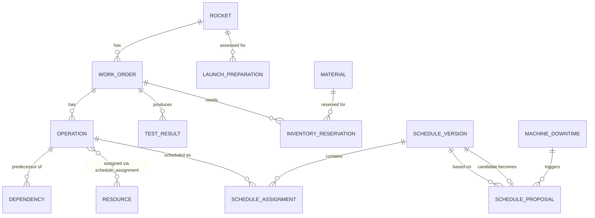

# Data model

## Relational schema (RDS PostgreSQL) — system of record, one shared database

One RDS instance, one schema, shared by all four Java services (see ADR-005 for why this is a
deliberate choice over database-per-service). Table ownership below indicates which service
**writes** that table — all services may read any table for their own read-only needs (e.g.
`event-processing-service` reads `resource` to resolve names to IDs), but only the owner writes.

This file is the frozen contract; the actual Flyway migration lives at
`services/work-order-service/src/main/resources/db/migration/V1__init.sql` (that service owns
the baseline schema migration since it owns the most foundational tables) and must match it. If
any workstream needs a schema change, update **this file first**, note it in a PR/commit
message, then apply the migration.

```sql
-- ============================================================================
-- Owned by: work-order-service
-- ============================================================================

-- Rocket: the top-level vehicle/mission a work order belongs to.
CREATE TABLE rocket (
    id                  BIGSERIAL PRIMARY KEY,
    name                VARCHAR(80) NOT NULL,       -- e.g. "New Glenn"
    variant             VARCHAR(80),                -- e.g. "NG-4"
    configuration       VARCHAR(120),
    launch_window_start TIMESTAMPTZ,
    launch_window_end   TIMESTAMPTZ,
    status              VARCHAR(20) NOT NULL CHECK (status IN ('IN_PRODUCTION','INTEGRATION','TEST','READY','LAUNCHED','SCRUBBED'))
);

-- Work orders: the top-level unit of manufacturing/assembly/integration/test work.
CREATE TABLE work_order (
    id              BIGSERIAL PRIMARY KEY,
    rocket_id       BIGINT NOT NULL REFERENCES rocket(id),
    part_number     VARCHAR(64) NOT NULL,
    title           VARCHAR(160) NOT NULL,
    work_type       VARCHAR(32) NOT NULL CHECK (work_type IN ('MANUFACTURING','ASSEMBLY','INTEGRATION','TEST','LAUNCH_PREP')),
    priority        VARCHAR(16) NOT NULL CHECK (priority IN ('CRITICAL','HIGH','MEDIUM','LOW')),
    due_at          TIMESTAMPTZ NOT NULL,
    status          VARCHAR(16) NOT NULL CHECK (status IN ('PLANNED','IN_PROGRESS','COMPLETE','LATE','BLOCKED')),
    created_at      TIMESTAMPTZ NOT NULL DEFAULT now(),
    updated_at      TIMESTAMPTZ NOT NULL DEFAULT now(),
    version         BIGINT NOT NULL DEFAULT 0
);

-- Operations: the schedulable steps belonging to a work order.
CREATE TABLE operation (
    id                      BIGSERIAL PRIMARY KEY,
    work_order_id           BIGINT NOT NULL REFERENCES work_order(id) ON DELETE CASCADE,
    name                    VARCHAR(160) NOT NULL,   -- e.g. "Engine Assembly"
    duration_minutes        INT NOT NULL CHECK (duration_minutes > 0),
    required_skill          VARCHAR(64) NOT NULL,
    required_resource_type  VARCHAR(64) NOT NULL,    -- e.g. ASSEMBLY_STATION, TEST_STAND, CLEAN_ROOM
    sequence_index          INT NOT NULL,
    status                  VARCHAR(16) NOT NULL DEFAULT 'PLANNED' CHECK (status IN ('PLANNED','IN_PROGRESS','COMPLETE','BLOCKED'))
);

-- Dependencies: operation cannot start until predecessor operation reaches dependency_type state.
CREATE TABLE dependency (
    operation_id             BIGINT NOT NULL REFERENCES operation(id) ON DELETE CASCADE,
    predecessor_operation_id BIGINT NOT NULL REFERENCES operation(id) ON DELETE CASCADE,
    dependency_type          VARCHAR(20) NOT NULL DEFAULT 'FINISH_START' CHECK (dependency_type IN ('FINISH_START','FINISH_FINISH')),
    PRIMARY KEY (operation_id, predecessor_operation_id),
    CHECK (operation_id <> predecessor_operation_id)
);

-- Resources: assembly stations, test stands, clean rooms, technicians (anything with finite capacity).
CREATE TABLE resource (
    id                  BIGSERIAL PRIMARY KEY,
    name                VARCHAR(120) NOT NULL,
    resource_type       VARCHAR(64) NOT NULL,       -- ASSEMBLY_STATION, TEST_STAND, CLEAN_ROOM, TECHNICIAN
    skills              TEXT[] NOT NULL DEFAULT '{}',
    capacity            INT NOT NULL DEFAULT 1,
    availability_status VARCHAR(16) NOT NULL CHECK (availability_status IN ('AVAILABLE','DOWN','MAINTENANCE'))
);

-- Materials and reservations (Materials Readiness Agent reads these; BOM/config control context).
CREATE TABLE material (
    id                  BIGSERIAL PRIMARY KEY,
    part_number         VARCHAR(64) NOT NULL UNIQUE,
    description         VARCHAR(200) NOT NULL,
    quantity_on_hand    INT NOT NULL DEFAULT 0,
    quantity_on_order   INT NOT NULL DEFAULT 0,
    supplier            VARCHAR(120),
    expected_at         TIMESTAMPTZ,
    status              VARCHAR(16) NOT NULL DEFAULT 'IN_STOCK' CHECK (status IN ('IN_STOCK','LOW','BACKORDERED'))
);

CREATE TABLE inventory_reservation (
    id              BIGSERIAL PRIMARY KEY,
    work_order_id   BIGINT NOT NULL REFERENCES work_order(id),
    material_id     BIGINT NOT NULL REFERENCES material(id),
    operation_id    BIGINT REFERENCES operation(id),
    quantity        INT NOT NULL CHECK (quantity > 0),
    status          VARCHAR(16) NOT NULL DEFAULT 'RESERVED' CHECK (status IN ('RESERVED','ALLOCATED','RELEASED')),
    reserved_at     TIMESTAMPTZ NOT NULL DEFAULT now()
);

-- ============================================================================
-- Owned by: scheduling-service
-- ============================================================================

-- Schedule versions are immutable once published. A new plan = a new version.
CREATE TABLE schedule_version (
    id              BIGSERIAL PRIMARY KEY,
    version_number  INT NOT NULL,
    status          VARCHAR(16) NOT NULL CHECK (status IN ('DRAFT','PROPOSED','PUBLISHED','SUPERSEDED','REJECTED')),
    is_current      BOOLEAN NOT NULL DEFAULT false,
    created_at      TIMESTAMPTZ NOT NULL DEFAULT now(),
    approved_by     VARCHAR(80),
    objective_score NUMERIC(12,4),
    UNIQUE (version_number)
);

CREATE TABLE schedule_assignment (
    id                  BIGSERIAL PRIMARY KEY,
    schedule_version_id BIGINT NOT NULL REFERENCES schedule_version(id) ON DELETE CASCADE,
    operation_id        BIGINT NOT NULL REFERENCES operation(id),
    resource_id         BIGINT NOT NULL REFERENCES resource(id),
    start_at            TIMESTAMPTZ NOT NULL,
    end_at              TIMESTAMPTZ NOT NULL,
    status              VARCHAR(16) NOT NULL DEFAULT 'SCHEDULED' CHECK (status IN ('SCHEDULED','IN_PROGRESS','COMPLETE')),
    UNIQUE (schedule_version_id, operation_id)
);

-- Schedule proposals: the output of a disruption-recovery Step Functions execution.
CREATE TABLE schedule_proposal (
    id                              BIGSERIAL PRIMARY KEY,
    machine_downtime_id             BIGINT REFERENCES machine_downtime(id),
    based_on_schedule_version_id    BIGINT NOT NULL REFERENCES schedule_version(id),
    candidate_schedule_version_id   BIGINT REFERENCES schedule_version(id),
    status                          VARCHAR(16) NOT NULL CHECK (status IN ('PENDING','APPROVED','REJECTED','EXPIRED')),
    agent_summary                   TEXT,
    agent_findings                  JSONB NOT NULL DEFAULT '{}',
    step_functions_task_token       TEXT,
    step_functions_execution_arn    TEXT,
    created_at                      TIMESTAMPTZ NOT NULL DEFAULT now(),
    decided_at                      TIMESTAMPTZ,
    decided_by                      VARCHAR(80)
);

-- Launch readiness rollups per rocket (written by scheduling-service from Launch Readiness Agent output + deterministic checks).
CREATE TABLE launch_preparation (
    id                  BIGSERIAL PRIMARY KEY,
    rocket_id           BIGINT NOT NULL REFERENCES rocket(id),
    readiness_status    VARCHAR(20) NOT NULL CHECK (readiness_status IN ('ON_TRACK','AT_RISK','BLOCKED','READY_FOR_LAUNCH')),
    readiness_score     NUMERIC(5,2),       -- 0-100
    weather_status      VARCHAR(20) CHECK (weather_status IN ('GO','NO_GO','UNKNOWN')),
    planned_launch_at   TIMESTAMPTZ,
    evaluated_at        TIMESTAMPTZ NOT NULL DEFAULT now(),
    notes               TEXT
);

-- ============================================================================
-- Owned by: event-processing-service
-- ============================================================================

-- Machine downtime / equipment disruption events.
CREATE TABLE machine_downtime (
    id                      BIGSERIAL PRIMARY KEY,
    event_id                VARCHAR(80) NOT NULL UNIQUE,  -- idempotency key, mirrors DynamoDB
    resource_id             BIGINT REFERENCES resource(id),
    started_at              TIMESTAMPTZ NOT NULL,
    estimated_recovery_at   TIMESTAMPTZ,
    reason                  VARCHAR(200),
    status                  VARCHAR(16) NOT NULL DEFAULT 'OPEN' CHECK (status IN ('OPEN','RESOLVED')),
    received_at             TIMESTAMPTZ NOT NULL DEFAULT now()
);

-- Test and integration results (engine tests, avionics, quality checks).
CREATE TABLE test_result (
    id              BIGSERIAL PRIMARY KEY,
    event_id        VARCHAR(80) NOT NULL UNIQUE,   -- idempotency key, mirrors DynamoDB
    work_order_id   BIGINT REFERENCES work_order(id),
    test_type       VARCHAR(80) NOT NULL,          -- e.g. ENGINE_HOT_FIRE, AVIONICS_INTEGRATION, QUALITY_INSPECTION
    result          VARCHAR(16) NOT NULL CHECK (result IN ('PASS','FAIL','CONDITIONAL')),
    performed_at    TIMESTAMPTZ NOT NULL,
    status          VARCHAR(16) NOT NULL DEFAULT 'RECORDED' CHECK (status IN ('RECORDED','REVIEWED')),
    artifact_s3_key VARCHAR(400),                  -- pointer into the S3 documents bucket, not the file itself
    received_at     TIMESTAMPTZ NOT NULL DEFAULT now()
);

-- ============================================================================
-- Shared / cross-cutting — owned by work-order-service (append-only, everyone writes via a shared client/library)
-- ============================================================================

CREATE TABLE audit_event (
    id              BIGSERIAL PRIMARY KEY,
    event_type      VARCHAR(64) NOT NULL,   -- e.g. WORK_ORDER_CREATED, DOWNTIME_RECEIVED, PROPOSAL_APPROVED, NOTIFICATION_SENT
    entity_type     VARCHAR(64) NOT NULL,
    entity_id       BIGINT,
    actor           VARCHAR(80) NOT NULL,
    detail          JSONB NOT NULL DEFAULT '{}',
    occurred_at     TIMESTAMPTZ NOT NULL DEFAULT now()
);

CREATE INDEX idx_work_order_rocket ON work_order(rocket_id);
CREATE INDEX idx_operation_work_order ON operation(work_order_id);
CREATE INDEX idx_schedule_assignment_version ON schedule_assignment(schedule_version_id);
CREATE INDEX idx_schedule_assignment_resource_time ON schedule_assignment(resource_id, start_at, end_at);
CREATE INDEX idx_audit_event_entity ON audit_event(entity_type, entity_id);
CREATE INDEX idx_proposal_status ON schedule_proposal(status);
CREATE INDEX idx_test_result_work_order ON test_result(work_order_id);
CREATE INDEX idx_launch_preparation_rocket ON launch_preparation(rocket_id);
```

### Optimistic locking

- `work_order.version` and `schedule_proposal` decisions are both optimistic-locked (JPA
  `@Version` on `work_order`; the proposal status transition uses a `WHERE status = 'PENDING'`
  conditional update — the second concurrent approval attempt gets `0` rows affected and the API
  returns `409 Conflict`, mirroring the pattern in the companion Mission Notes project).

## DynamoDB — narrow, high-churn, key-value concerns

### `IdempotencyRecords`
| Attribute | Type | Notes |
| --- | --- | --- |
| `eventId` (PK) | String | e.g. `evt-9001` from a downtime or test-result event |
| `status` | String | `PROCESSING` \| `COMPLETED` |
| `resultSummary` | String | optional, for debugging |
| `ttl` | Number | DynamoDB TTL attribute, ~7 days |

Used by `event-processing-service` to guarantee the same `eventId` never creates two
`machine_downtime`/`test_result` rows or two Step Functions executions, even under SQS
at-least-once delivery or consumer crash-after-persist-before-ack.

### `WorkflowState`
| Attribute | Type | Notes |
| --- | --- | --- |
| `executionArn` (PK) | String | Step Functions execution ARN |
| `proposalId` | Number | FK-ish reference to `schedule_proposal.id` in Postgres |
| `taskToken` | String | current `waitForTaskToken` value, if paused for approval |
| `updatedAt` | String (ISO-8601) | |

Lets `scheduling-service`'s approve/reject endpoints find the right Step Functions task token to
resume, without Postgres needing to know anything about Step Functions internals (kept there
too, in `schedule_proposal.step_functions_task_token`, as a pragmatic denormalization — ADR-001).

### `AgentMemory` (P1/P2 — optional, only if the agent service wants cross-run context)
| Attribute | Type | Notes |
| --- | --- | --- |
| `rocketId` (PK) | Number | |
| `lastAssessment` | String (JSON) | Most recent Launch Readiness Agent output, for trend context |
| `updatedAt` | String (ISO-8601) | |

## S3 — documents, CAD, test reports, simulation data, artifacts

Bucket: `aeroplan-documents` (see `infrastructure-spec.md`). Postgres never stores file bytes —
`test_result.artifact_s3_key` and similar fields store only the S3 object key. For this demo,
`event-processing-service` may write small synthetic "test report" text/JSON files to
demonstrate the pattern; large binary CAD/simulation files are out of scope (documented as such,
not silently ignored).

## Entity-relationship summary


