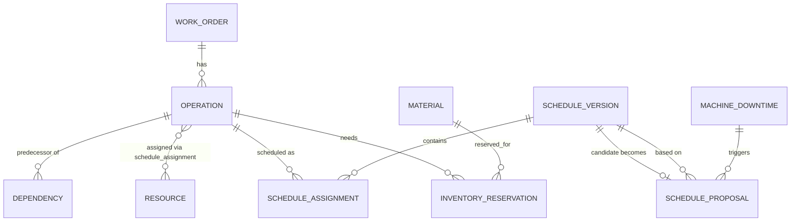

# Data model

## Relational schema (RDS PostgreSQL) — system of record

Owned by `scheduling-service` (writes) with `manufacturing-event-service` writing only to
`machine_downtime` and reading `operation`/`resource` for impact analysis. This file is the
frozen contract; the actual Flyway migration lives at
`services/scheduling-service/src/main/resources/db/migration/V1__init.sql` and must match it.
If a workstream needs a schema change, update **this file first**, note it in a PR/commit
message, then apply the migration.

```sql
-- Work orders: the top-level unit of manufacturing work.
CREATE TABLE work_order (
    id              BIGSERIAL PRIMARY KEY,
    part_number     VARCHAR(64) NOT NULL,
    title           VARCHAR(160) NOT NULL,
    priority        VARCHAR(16) NOT NULL CHECK (priority IN ('CRITICAL','HIGH','MEDIUM','LOW')),
    due_at          TIMESTAMPTZ NOT NULL,
    status          VARCHAR(16) NOT NULL CHECK (status IN ('PLANNED','IN_PROGRESS','COMPLETE','LATE','BLOCKED')),
    created_at      TIMESTAMPTZ NOT NULL DEFAULT now(),
    updated_at      TIMESTAMPTZ NOT NULL DEFAULT now(),
    version         BIGINT NOT NULL DEFAULT 0
);

-- Operations: the schedulable steps belonging to a work order.
CREATE TABLE operation (
    id                  BIGSERIAL PRIMARY KEY,
    work_order_id       BIGINT NOT NULL REFERENCES work_order(id) ON DELETE CASCADE,
    name                VARCHAR(160) NOT NULL,
    duration_minutes    INT NOT NULL CHECK (duration_minutes > 0),
    required_skill      VARCHAR(64) NOT NULL,
    required_resource_type VARCHAR(64) NOT NULL,
    sequence_index      INT NOT NULL
);

-- Dependencies: operation cannot start until predecessor operation is COMPLETE.
CREATE TABLE dependency (
    operation_id            BIGINT NOT NULL REFERENCES operation(id) ON DELETE CASCADE,
    predecessor_operation_id BIGINT NOT NULL REFERENCES operation(id) ON DELETE CASCADE,
    PRIMARY KEY (operation_id, predecessor_operation_id),
    CHECK (operation_id <> predecessor_operation_id)
);

-- Resources: assembly stations, machines, technicians (anything with finite capacity).
CREATE TABLE resource (
    id                  BIGSERIAL PRIMARY KEY,
    name                VARCHAR(120) NOT NULL,
    resource_type       VARCHAR(64) NOT NULL,
    skills              TEXT[] NOT NULL DEFAULT '{}',
    capacity            INT NOT NULL DEFAULT 1,
    availability_status VARCHAR(16) NOT NULL CHECK (availability_status IN ('AVAILABLE','DOWN','MAINTENANCE'))
);

-- Materials and reservations (Materials Readiness Agent reads these).
CREATE TABLE material (
    id                  BIGSERIAL PRIMARY KEY,
    part_number         VARCHAR(64) NOT NULL UNIQUE,
    description         VARCHAR(200) NOT NULL,
    on_hand_quantity    INT NOT NULL DEFAULT 0,
    on_order_quantity   INT NOT NULL DEFAULT 0,
    expected_at         TIMESTAMPTZ
);

CREATE TABLE inventory_reservation (
    id              BIGSERIAL PRIMARY KEY,
    material_id     BIGINT NOT NULL REFERENCES material(id),
    operation_id    BIGINT NOT NULL REFERENCES operation(id),
    quantity        INT NOT NULL CHECK (quantity > 0),
    reserved_at     TIMESTAMPTZ NOT NULL DEFAULT now()
);

-- Schedule versions are immutable once published. A new plan = a new version.
CREATE TABLE schedule_version (
    id              BIGSERIAL PRIMARY KEY,
    version_number  INT NOT NULL,
    status          VARCHAR(16) NOT NULL CHECK (status IN ('DRAFT','PROPOSED','PUBLISHED','SUPERSEDED','REJECTED')),
    created_at      TIMESTAMPTZ NOT NULL DEFAULT now(),
    published_at    TIMESTAMPTZ,
    approved_by     VARCHAR(80),
    objective_score NUMERIC(12,4),
    UNIQUE (version_number)
);

CREATE TABLE schedule_assignment (
    id                  BIGSERIAL PRIMARY KEY,
    schedule_version_id BIGINT NOT NULL REFERENCES schedule_version(id) ON DELETE CASCADE,
    operation_id        BIGINT NOT NULL REFERENCES operation(id),
    resource_id         BIGINT NOT NULL REFERENCES resource(id),
    start_at            TIMESTAMPTZ NOT NULL,
    end_at              TIMESTAMPTZ NOT NULL,
    UNIQUE (schedule_version_id, operation_id)
);

-- Machine downtime / disruption events (written by manufacturing-event-service).
CREATE TABLE machine_downtime (
    id                      BIGSERIAL PRIMARY KEY,
    event_id                VARCHAR(80) NOT NULL UNIQUE,  -- idempotency key, mirrors DynamoDB
    resource_id             BIGINT REFERENCES resource(id),
    started_at              TIMESTAMPTZ NOT NULL,
    estimated_recovery_at   TIMESTAMPTZ,
    reason                  VARCHAR(200),
    received_at             TIMESTAMPTZ NOT NULL DEFAULT now()
);

-- Schedule proposals: the output of a disruption-recovery Step Functions execution.
CREATE TABLE schedule_proposal (
    id                          BIGSERIAL PRIMARY KEY,
    machine_downtime_id         BIGINT REFERENCES machine_downtime(id),
    based_on_schedule_version_id BIGINT NOT NULL REFERENCES schedule_version(id),
    candidate_schedule_version_id BIGINT REFERENCES schedule_version(id),
    status                      VARCHAR(16) NOT NULL CHECK (status IN ('PENDING','APPROVED','REJECTED','EXPIRED')),
    agent_summary               TEXT,
    agent_findings              JSONB NOT NULL DEFAULT '{}',
    step_functions_task_token   TEXT,
    step_functions_execution_arn TEXT,
    created_at                  TIMESTAMPTZ NOT NULL DEFAULT now(),
    decided_at                  TIMESTAMPTZ,
    decided_by                  VARCHAR(80)
);

-- Append-only audit trail for every scheduling decision.
CREATE TABLE audit_event (
    id              BIGSERIAL PRIMARY KEY,
    event_type      VARCHAR(64) NOT NULL,   -- e.g. WORK_ORDER_CREATED, DOWNTIME_RECEIVED, PROPOSAL_APPROVED
    entity_type     VARCHAR(64) NOT NULL,
    entity_id       BIGINT,
    actor           VARCHAR(80) NOT NULL,
    detail          JSONB NOT NULL DEFAULT '{}',
    occurred_at     TIMESTAMPTZ NOT NULL DEFAULT now()
);

CREATE INDEX idx_operation_work_order ON operation(work_order_id);
CREATE INDEX idx_schedule_assignment_version ON schedule_assignment(schedule_version_id);
CREATE INDEX idx_schedule_assignment_resource_time ON schedule_assignment(resource_id, start_at, end_at);
CREATE INDEX idx_audit_event_entity ON audit_event(entity_type, entity_id);
CREATE INDEX idx_proposal_status ON schedule_proposal(status);
```

### Optimistic locking

- `work_order.version` and `schedule_version` publication are both optimistic-locked (JPA
  `@Version` on `work_order`; `schedule_proposal.status` transition for the latter uses a
  `WHERE status = 'PENDING'` conditional update — the second concurrent approval attempt gets
  `0` rows affected and the API returns `409 Conflict`, mirroring the pattern in the companion
  Mission Notes project).

## DynamoDB — narrow, high-churn, key-value concerns

### `IdempotencyRecords`
| Attribute | Type | Notes |
| --- | --- | --- |
| `eventId` (PK) | String | e.g. `evt-9001` from the downtime event |
| `status` | String | `PROCESSING` \| `COMPLETED` |
| `resultSummary` | String | optional, for debugging |
| `ttl` | Number | DynamoDB TTL attribute, ~7 days |

Used by `manufacturing-event-service` to guarantee the same `eventId` never creates two
`machine_downtime` rows or two Step Functions executions, even under SQS at-least-once delivery
or consumer crash-after-persist-before-ack.

### `WorkflowState`
| Attribute | Type | Notes |
| --- | --- | --- |
| `executionArn` (PK) | String | Step Functions execution ARN |
| `proposalId` | Number | FK-ish reference to `schedule_proposal.id` in Postgres |
| `taskToken` | String | current `waitForTaskToken` value, if paused for approval |
| `updatedAt` | String (ISO-8601) | |

Lets `scheduling-service`'s approve/reject endpoints find the right Step Functions task token
to resume, without Postgres needing to know anything about Step Functions internals (kept there
too, in `schedule_proposal.step_functions_task_token`, as a pragmatic denormalization — see
ADR-001 for why both exist).

## Entity-relationship summary


