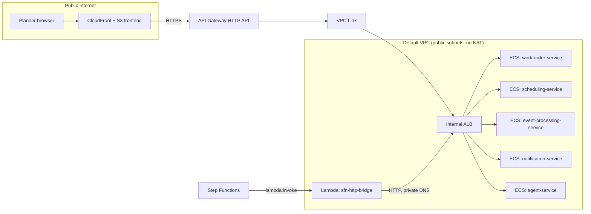

# Infrastructure specification (frozen contract — v1)

**Account:** `420374519668` · **Region:** `us-east-2` · **Name prefix for all resources:** `aeroplan-`

This is the contract the `infrastructure/terraform` workstream implements. Other workstreams
(Java services, Python agent service, frontend) only need the **environment variable names** in
the last section — they should never hardcode ARNs, URLs, or secrets.

## Networking — reuse the existing default VPC, no NAT Gateway

- VPC: default VPC already present in this account (`vpc-44944f2f`, `172.31.0.0/16`,
  `us-east-2`). Terraform reads it via a `data "aws_vpc" "default"` + `data "aws_subnets"`
  lookup — it does **not** create a new VPC.
- All ECS Fargate tasks run in the default **public** subnets with `assign_public_ip = true`
  (no NAT Gateway cost), but are only reachable from:
  - the internal ALB's security group (for HTTP traffic), and
  - nothing else inbound (no direct internet ingress to the tasks themselves).
- The ALB (`aeroplan-internal-alb`) is **internal** (`internal = true`, no public IP), in the
  same public subnets (an internal ALB can live in subnets with an IGW route — it simply isn't
  assigned a public IP itself).
- A single Lambda function (`aeroplan-sfn-http-bridge`) runs attached to the same VPC/subnets so
  it can reach the internal ALB by private DNS; no NAT Gateway needed since it never calls the
  public internet.
- API Gateway (HTTP API) reaches the same internal ALB via a **VPC Link**.

## Compute (ECS Fargate)

| Service | CPU / Memory | Desired count | ALB path prefix(es) |
| --- | --- | --- | --- |
| `aeroplan-work-order-service` | 256 / 512 | 1 | `/api/rockets*`, `/api/work-orders*`, `/api/resources*`, `/api/materials*`, `/api/audit-events*`, `/graphql` |
| `aeroplan-scheduling-service` | 256 / 512 | 1 | `/api/schedules*`, `/api/proposals*`, `/api/launch-readiness*`, `/internal/proposals*` |
| `aeroplan-event-processing-service` | 256 / 512 | 1 | `/api/disruptions*`, `/api/test-results*` |
| `aeroplan-notification-service` | 256 / 512 | 1 | `/api/notifications*`, `/internal/notifications*` |
| `aeroplan-agent-service` | 512 / 1024 | 1 | `/agents/*` |

One ECS cluster: `aeroplan-cluster`. One ALB with path-based listener rules routing to five
target groups. Container images: ECR repos named identically to the ECS service names above —
each service workstream owns its own `Dockerfile`; the infra workstream owns the ECR repos + ECS
task definitions/services (parameterized by image tag, pushed by CI).

## Data

- RDS PostgreSQL: identifier `aeroplan-db`, engine `postgres` 16, `db.t4g.micro`, 20GB gp3,
  single-AZ, `publicly_accessible = false`, database name `aeroplan`. Security group allows
  inbound 5432 only from the ECS tasks' security group. Credentials in Secrets Manager
  (`aeroplan/rds/credentials`), injected into ECS task definitions as secrets (never plaintext
  env vars, never committed). Shared by all four Java services (see ADR-005).
- DynamoDB tables: `aeroplan-idempotency-records` (PK `eventId`, TTL attribute `ttl`, on-demand
  billing), `aeroplan-workflow-state` (PK `executionArn`, on-demand billing), optionally
  `aeroplan-agent-memory` (PK `rocketId`, on-demand billing, P1/P2 — only if `agent-service`
  implements cross-run memory).
- S3: bucket `aeroplan-documents-<random-suffix>` (private, no public access) for test
  reports/CAD/simulation artifacts (see ADR-007). Written by `event-processing-service`, read by
  the frontend via short-lived presigned URLs generated by `work-order-service` or
  `event-processing-service` (P1 — not required for P0's core demo path).

## Messaging & orchestration

- SQS: `aeroplan-manufacturing-events` (main, shared by both `MACHINE_DOWNTIME` and
  `TEST_RESULT` event types) + `aeroplan-manufacturing-events-dlq` (DLQ, `maxReceiveCount = 5`
  on the main queue's redrive policy).
- SNS: `aeroplan-schedule-notifications` (topic only; email subscription is a Terraform
  variable — `notification_email`, optional — so the demo doesn't require a mailbox to deploy).
- Step Functions: state machine `aeroplan-disruption-recovery`, Standard type, definition
  rendered from `workflows/step-functions/disruption-recovery.asl.json` via
  `templatefile(..., { http_bridge_lambda_arn = aws_lambda_function.sfn_http_bridge.arn })`.
- Lambda: `aeroplan-sfn-http-bridge` — generic HTTP forwarder (Python 3.12, ~40 lines using
  `urllib3`), VPC-attached, takes `{method, path, body}` from its event payload and returns
  `{statusCode, body}` from calling `http://aeroplan-internal-alb.<region>.elb.amazonaws.com{path}`.

## Edge / public surface

- API Gateway HTTP API: `aeroplan-api`. Routes `/api/{proxy+}`, `/graphql`, and `/agents/{proxy+}`
  (internal-only path, **not** exposed through API Gateway — only reachable by the Lambda bridge
  directly against the ALB) → VPC Link → ALB (path preserved). CORS enabled for the CloudFront
  origin only (not `*`).
- Frontend: S3 bucket `aeroplan-frontend-<random-suffix>` (private, CloudFront Origin Access
  Control only) + CloudFront distribution. Build output (`frontend/dist`) is synced to the
  bucket by CI after `npm run build`; CloudFront caches it with a short TTL for a fast
  demo-iteration loop. `VITE_API_URL` is baked into the build pointing at the API Gateway
  invoke URL (or custom domain, if later added as P2).

## IAM (least-privilege, per task role — infra workstream authors these precisely)

- `work-order-service` task role: RDS (via network only, not IAM auth); read access to the S3
  documents bucket for presigned-URL generation (P1).
- `scheduling-service` task role: RDS, DynamoDB `aeroplan-workflow-state` read/write, SNS
  `Publish` on `aeroplan-schedule-notifications` (if calling SNS directly rather than through
  `notification-service` — document whichever path you implement), Step Functions
  `SendTaskSuccess` + `SendTaskFailure` (resource: the state machine's executions, scoped via
  condition where possible).
- `event-processing-service` task role: RDS, SQS consume on `aeroplan-manufacturing-events`,
  DynamoDB `aeroplan-idempotency-records` read/write, Step Functions `StartExecution` on
  `aeroplan-disruption-recovery`, S3 write access to the documents bucket.
- `notification-service` task role: SNS `Publish` on `aeroplan-schedule-notifications`.
- `agent-service` task role: Bedrock `InvokeModel`/`Converse` on the specific model ID(s) used
  (`anthropic.claude-haiku-4-5-20251001-v1:0` default — cheap, fast, good enough for structured
  JSON extraction; configurable).
- `aeroplan-sfn-http-bridge` Lambda role: VPC ENI management (`AWSLambdaVPCAccessExecutionRole`)
  only — it has no AWS API permissions beyond that; it's a pure network bridge.

## CI/CD (GitHub Actions — P1, added once the manual deploy path works)

- `ci.yml`: build + test each service on every push/PR (mirrors the companion Mission Notes
  project's pattern: backend tests, frontend lint/build, and later a container build job per
  service — now five backend services instead of two).
- `deploy.yml` (manually triggered or on `main`, P1): build images, push to ECR, `terraform
  apply` (or `aws ecs update-service --force-new-deployment`), then sync the frontend build to
  S3 + CloudFront invalidation. Requires the repo's GitHub Actions to assume an AWS IAM role via
  OIDC (`aws-actions/configure-aws-credentials` with `role-to-assume`, **not** long-lived access
  keys committed as secrets) — the infra workstream should create this IAM role/OIDC provider
  as part of its Terraform.

## Environment variables (the actual cross-team contract)

### `work-order-service`
| Variable | Example | Notes |
| --- | --- | --- |
| `SPRING_DATASOURCE_URL` | `jdbc:postgresql://aeroplan-db.xxxx.us-east-2.rds.amazonaws.com:5432/aeroplan` | |
| `SPRING_DATASOURCE_USERNAME` / `_PASSWORD` | — | From Secrets Manager at runtime |
| `AWS_REGION` | `us-east-2` | |
| `S3_DOCUMENTS_BUCKET` | `aeroplan-documents-xxxxx` | For presigned URL generation (P1) |

### `scheduling-service`
| Variable | Example | Notes |
| --- | --- | --- |
| `SPRING_DATASOURCE_URL` / `_USERNAME` / `_PASSWORD` | same RDS instance as above |
| `AWS_REGION` | `us-east-2` | |
| `DYNAMODB_WORKFLOW_TABLE` | `aeroplan-workflow-state` | |
| `SNS_NOTIFICATIONS_TOPIC_ARN` | `arn:aws:sns:us-east-2:420374519668:aeroplan-schedule-notifications` | only if calling SNS directly instead of via notification-service |
| `NOTIFICATION_SERVICE_BASE_URL` | `http://aeroplan-internal-alb.us-east-2.elb.amazonaws.com` | if delegating to notification-service instead |
| `STEP_FUNCTIONS_STATE_MACHINE_ARN` | `arn:aws:states:us-east-2:420374519668:stateMachine:aeroplan-disruption-recovery` | used only to validate/log, since SendTaskSuccess needs just the task token |

### `event-processing-service`
| Variable | Example |
| --- | --- |
| `SPRING_DATASOURCE_URL` / `_USERNAME` / `_PASSWORD` | same RDS instance as above |
| `AWS_REGION` | `us-east-2` |
| `SQS_MANUFACTURING_EVENTS_QUEUE_URL` | `https://sqs.us-east-2.amazonaws.com/420374519668/aeroplan-manufacturing-events` |
| `DYNAMODB_IDEMPOTENCY_TABLE` | `aeroplan-idempotency-records` |
| `STEP_FUNCTIONS_STATE_MACHINE_ARN` | `arn:aws:states:us-east-2:420374519668:stateMachine:aeroplan-disruption-recovery` |
| `S3_DOCUMENTS_BUCKET` | `aeroplan-documents-xxxxx` |

### `notification-service`
| Variable | Example |
| --- | --- |
| `AWS_REGION` | `us-east-2` |
| `SNS_NOTIFICATIONS_TOPIC_ARN` | `arn:aws:sns:us-east-2:420374519668:aeroplan-schedule-notifications` |

### `agent-service`
| Variable | Example |
| --- | --- |
| `AWS_REGION` | `us-east-2` |
| `BEDROCK_MODEL_ID` | `anthropic.claude-haiku-4-5-20251001-v1:0` |
| `WORK_ORDER_SERVICE_BASE_URL` | `http://aeroplan-internal-alb.us-east-2.elb.amazonaws.com` (for supplementary read-only tool calls only) |

### `frontend`
| Variable | Example |
| --- | --- |
| `VITE_API_URL` | API Gateway invoke URL, e.g. `https://abc123.execute-api.us-east-2.amazonaws.com` |

## Cost estimate (rough, for the demo footprint above)

RDS `db.t4g.micro` (~$12/mo) + 5× Fargate 0.25–0.5 vCPU tasks running continuously (~$40–50/mo
combined) + ALB (~$16/mo) + DynamoDB/SQS/SNS/Step Functions/Lambda (all pay-per-use, a few
dollars/mo at demo volumes) + S3/CloudFront (cents) + Bedrock (pay-per-token, depends on usage —
each disruption-recovery run is a handful of short Claude Haiku calls, a few cents each).
**Ballpark: $75–100/month if left running continuously.** Document in the root README that
`terraform destroy` (or scaling ECS desired counts to 0 + stopping the RDS instance) should be
used between demo sessions to avoid unnecessary spend — this is itself worth mentioning as
operational awareness in an interview.
